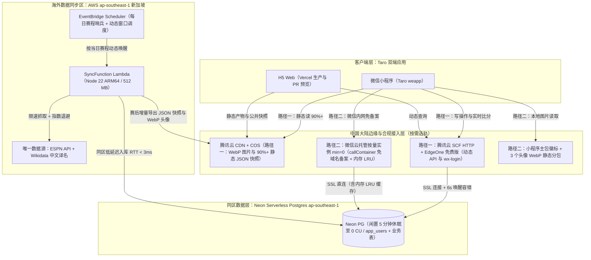
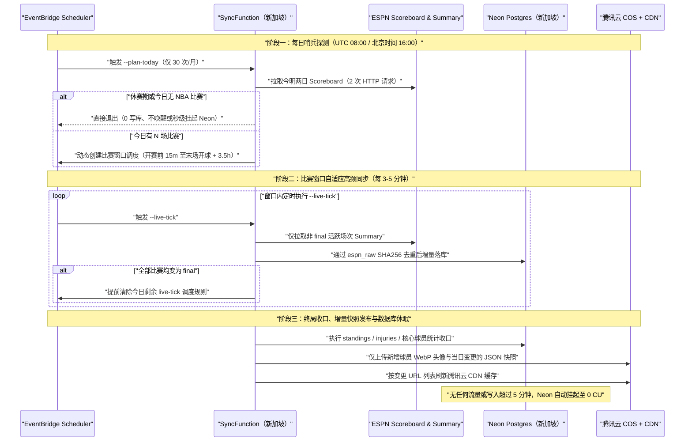

# NBA Games with Friends (v2) — 按需付费 Serverless 架构设计文档

- **文档状态**：Architecture Design / 待评审（基于分支 `v2` HEAD `e9f90d6`）
- **目标分支**：`v2`（仅增量变更，严禁触碰 `dev` / `legacy-v1`）
- **适用范围**：H5 Web（Vercel 预览与公网）+ 微信小程序（Taro + React，中国大陆合规上线与低延迟访问）+ 异步 ESPN 数据同步后端

---

## 1. 背景、核心约束与设计目标

### 1.1 项目背景

`nba-games-with-friends` v2 是一套基于 **Taro + React**（同时构建 H5 与微信小程序）、**Node.js 22 Serverless API**、**ESPN 数据同步脚本** 与 **PostgreSQL** 的 NBA 赛程、实时比分、球员/球队技术统计与好友房间（Group / Lineup）应用。

当前 `v2` 已完成基础数据模型、API 路由与 H5/小程序前端页面原型，但基础设施仍沿用早期的“海外 AWS Lambda + CloudFront + Supabase + 固定每 10 分钟唤醒同步”模式，面临 **休眠停服 vs 固定高月租**、**定时空转破坏 Scale-to-Zero**、以及 **中国大陆微信小程序无法通过域名校验与工信部备案上线** 等关键阻塞。

### 1.2 硬性工程约束（遵循 `AGENTS.md`）

本文档所有架构选型、表结构演进与接口扩展必须严格遵守项目根目录 [`AGENTS.md`](../AGENTS.md)：

1. **严禁 Fantasy 积分/评分体系（No fantasy points/scoring anywhere）**：无论是数据库表结构、API 返回字段还是前端 UI（包括 `lineups` 阵型选择），均不得引入任何 Fantasy 积分计算或评分规则。
2. **ESPN 为唯一体育数据源**：所有赛程、球队、球员、伤病、技术统计均仅由 ESPN 接口拉取（`name_zh` 中文译名允许借助 Wikidata + OpenCC 离线/增量补全）。
3. **API 契约仅允许向后兼容的增量变更**：严格遵守 [`docs/API-CONTRACT.md`](./API-CONTRACT.md)，不得破坏既有 `/api/v1/*` 路由的字段语义、错误结构与列表包裹格式。
4. **分支、预览与密钥规范**：
   - `dev` 保留 v1，严禁在 v2 工作中修改 `dev`；`v2` 为当前集成分支，所有开发均在短生命周期分支上进行，并通过 PR 合入 `v2`。
   - **强制 Vercel 预览验证**：任何代码或配置变更必须在对应的 Vercel Preview 环境验证通过后方可合并/发布。
   - **严禁提交密钥**：`DATABASE_URL`、微信 `AppSecret`、JWT Secret、对象存储凭据等仅可存于环境变量或云厂商密钥托管服务（SSM / Secrets Manager / Vercel Env / 云托管环境变量），禁止硬编码入仓库。

### 1.3 核心设计目标

| 维度 | 目标定义 | 量化指标 / 验收标准 |
| :--- | :--- | :--- |
| **零闲置成本（Pay-per-Use）** | 无常驻虚拟机或固定包月实例，覆盖定时同步、静态资源与图片、数据库、API、鉴权、日志全链路 | 休赛期 / 闲置月成本趋近 **`$0 / ¥0`**（`< $0.10 / ¥1.0`）；小流量月成本 `< ¥40` |
| **双端统一低成本支撑** | 同一套后端数据源同时服务 H5 Web（Vercel 预览与公网）与微信小程序（中国大陆公网） | 静态资源与 JSON 快照承接 `90%+` 读请求 |
| **中国大陆体验与合规** | 解决大陆访问 Vercel / AWS / Supabase / ESPN CDN 丢包裂图问题，全面满足微信上线红线 | 满足工信部 App 备案、域名 ICP 备案（或免域名备案内网链路）、个人类目合规与图片主包 `< 2 MB` |
| **平稳渐进迁移** | 最大化复用现有 `api/handlers.ts`、`sync/`、`scripts/export-snapshot.ts` 与 `supabase/migrations/` | 通过 `local/pglite.ts`、`sync/schema-test.mjs` 与 Vercel Preview 逐阶段验证 |

---

## 2. 现有 `v2` 架构全景盘点与痛点分析

> 本章盘点精确基于仓库 `v2` 分支 HEAD `e9f90d6`。

### 2.1 现有组件全景盘点

#### 2.1.1 构建体系与 CI 流水线
- **构建入口（[`package.json`](../package.json) + [`build.mjs`](../build.mjs)）**：使用 `esbuild` 将 [`api/lambda.ts`](../api/lambda.ts) 打包为 `dist/api/index.mjs`，将 [`sync/lambda.ts`](../sync/lambda.ts) 打包为 `dist/sync/index.mjs`（目标平台 `node22` ESM，排除 `pg-native`）。
- **TypeScript 工程范围**：根目录 [`tsconfig.json`](../tsconfig.json) 覆盖 `api/` 与 `local/`；`app/` 拥有独立的 Taro TS 配置。
- **CI 检查（[`.github/workflows/ci.yml`](../.github/workflows/ci.yml)）**：在 Node 20 环境下运行 `app/` 类型检查、`build:h5`（mock 模式）、`build:weapp`，强制校验微信小程序主包体积 **`< 2,097,152` 字节（2 MB）**，并归档 `h5-dist`。
- **文档现状说明**：当前 `v2` 仓库中**尚不存在** `PLAN.md`、`docs/API-EXAMPLES.md` 与 `RUN-LOG.md`；实际工程约束与接口基线以 `AGENTS.md`、`docs/API-CONTRACT.md`、`docs/FRONTEND-REQUESTS.md` 及各模块源码为准。

#### 2.1.2 基础设施（[`infra/template.yaml`](../infra/template.yaml)）
- **区域与运行时**：AWS SAM 模板部署于 `ap-northeast-1`（东京），全局 `nodejs22.x` + `arm64`，默认内存 `256 MB`。
- **`ApiFunction`**：超时 `10s`，`ReservedConcurrentExecutions: 10`，挂载 `FunctionUrlConfig`（`AuthType: NONE`、`InvokeMode: BUFFERED`）。
- **`SyncFunction`**：超时 `900s`（Lambda 硬上限），内存 `512 MB`，`ReservedConcurrentExecutions: 1`，环境变量 `ESPN_CACHE_DIR=/tmp/espn-cache`。配置有两条 EventBridge `ScheduleV2` 定时规则：
  - `Every10Min`：`cron(*/10 0-7,23 * * ? *)` —— 覆盖 UTC 23:00–07:59（每天连续 9 小时每 10 分钟触发 1 次 = 54 次/天 ≈ 1,620 次/月），传参 `--games-only --days-back=1 --ahead=1`。
  - `Nightly`：`cron(0 9 * * ? *)` —— 每日 1 次（18:00 JST），传参 `--days-back=2 --team-stats --zh-names`。
- **分发层（`CloudFront Distribution`）**：采用 `PriceClass_200`（含日本/香港等亚洲边缘节点）与 `http2and3`，挂载 `WebBucket`（S3 + OAC）和 `ApiFunctionUrl`；`/api/*` 路径按源站 `Cache-Control` 缓存（`MinTTL: 0`、`DefaultTTL: 0`、`MaxTTL: 86400`，转发全部 QueryString）。

#### 2.1.3 API 服务层（`api/`）
- **连接池配置（[`api/db.ts`](../api/db.ts)）**：使用 `pg.Pool`，当前配置 `max: 1`、`idleTimeoutMillis: 10_000`、`connectionTimeoutMillis: 3_000`、`statement_timeout: 5_000`、`query_timeout: 6_000`，通过正则 `/sslmode=require|supabase/` 判断是否启用 SSL。
- **路由实现（[`api/handlers.ts`](../api/handlers.ts)）**：已实现 14 个只读路由：
  - `/api/v1/health`、`/meta`、`/teams`、`/teams/:id`、`/standings`、`/players`、`/players/:id`、`/players/:id/gamelog`、`/leaders`、`/games`、`/games/:id`、`/games/:id/plays`、`/injuries`、`/stats/players`。
  - 使用 3 档缓存响应头：`SHORT`（`max-age=15, s-maxage=30, stale-while-revalidate=120`）、`MID`（`60 / 300 / 3600`）、`LONG`（`300 / 3600 / 86400`）。
- **前后端契约差异（见 [`docs/FRONTEND-REQUESTS.md`](./FRONTEND-REQUESTS.md)）**：
  - 前端 [`app/src/lib/api.ts`](../app/src/lib/api.ts) 与 [`app/src/pages/standings/index.tsx`](../app/src/pages/standings/index.tsx) 已发起 `GET /api/v1/stats/teams` 请求，但 `api/handlers.ts` 尚未实现该路由（请求模式会报错）。
  - `executives` 恒为 `null`（ESPN 无管理层数据，属预期缺省）。
  - 球队阵容、leaders、injuries 列表中的球员对象尚缺少 `last_name` 与 `short_name` 字段。

#### 2.1.4 数据库 Schema（`supabase/migrations/20261028000001..006_*.sql`）
当前共包含 **29 张表 + 4 个视图**（`005` 迁移启用 `security_invoker = true`：`player_box_season_totals`、`player_box_season_averages`、`player_season_stats`、`player_season_ranks`）及辅助函数/触发器（`set_updated_at`、`handle_new_user`、`add_owner_member`、`enforce_lineup_lock`、`is_group_member`、`join_group`）：

| 迁移文件 | 业务域 | 表清单（共 29 张） | 关键依赖与特征 |
| :--- | :--- | :--- | :--- |
| `001_core_reference.sql` | 基础资料与去重 | `ingest_jobs`, `espn_raw`, `team_i18n`, `position_i18n`, `venues`, `teams`, `coaches`, `players`, `player_team_history`, `player_salaries`（10 表） | `espn_raw` 存 SHA256 用于幂等去重 |
| `002_games.sql` | 赛程与比赛明细 | `games`, `game_periods`, `game_team_stats`, `player_game_stats`, `game_officials`, `game_broadcasts`, `game_odds`, `game_plays`, `game_win_probability`（9 表） | 含 `game_odds` 赔率表（微信合规高危字段） |
| `003_standings_stats.sql` | 排名、伤病与高阶统计 | `standings`, `injuries`, `team_season_stats`, `player_season_stats_espn`（4 表） | 支撑排行榜与球队统计对比 |
| `004_social.sql` | 好友房间与阵型 | `profiles`, `groups`, `group_members`, `contests`, `lineups`, `lineup_players`（6 表） | **强依赖 Supabase `auth.users(id)`** |
| `005_views.sql` | 统计聚合视图 | 4 个赛季统计与排名视图 | `security_invoker = true` |
| `006_rls.sql` | 行级安全策略 | 全量 29 张表启用 RLS | **强依赖 Supabase `auth.uid()`** |

#### 2.1.5 数据同步与本地工具链（`sync/`、`scripts/`、`local/`）
- **ESPN 请求与限流（[`sync/src/espn.ts`](../sync/src/espn.ts)）**：`site.api.espn.com` 限速 `MIN_GAP_MS = 1000`、`sports.core.api.espn.com` 限速 `ESPN_CORE_GAP_MS = 600`；最多 5 次指数退避重试（`2000 * 2**attempt + jitter`）。
- **同步编排（[`sync/src/sync.ts`](../sync/src/sync.ts)）**：
  - `--games-only` 模式虽跳过 `syncTeams`（31 次请求）和 `syncRoster`（30 次请求），但仍每次都执行 `syncStandings`、`syncInjuries`、`syncScoreboard`、`syncSummary` 与 `syncCoreStats`。
  - `syncCoreStats` 依赖 `/tmp/espn-cache` 的 6 小时本地文件缓存避重。
  - `--full` 全量冷跑约需 **22 分钟**；`--zh-names` 依赖 Wikidata SPARQL 与 `opencc-js`。
- **本地开发与快照脚本**：包含 [`local/server.ts`](../local/server.ts)、[`local/pglite.ts`](../local/pglite.ts)、[`sync/schema-test.mjs`](../sync/schema-test.mjs) 以及 [`scripts/export-snapshot.ts`](../scripts/export-snapshot.ts)（`docs/API-CONTRACT.md` 规划全量静态快照约为 `~1,000` 个 JSON 文件 / `~42 MB`，目前仅手动执行，尚未接入自动化发布流水线）。

#### 2.1.6 前端与云函数（`app/`）
- **构建配置**：Taro + React 双端构建 `h5` 与 `weapp`。`.env.development` 和 `.env.production` 默认均为 `TARO_APP_API_MODE="mock"`。
- **请求模式缺口（[`app/src/lib/api.ts`](../app/src/lib/api.ts)）**：目前仅支持 `mock` 与线上直连，**尚未实现 `snapshot` 静态快照路径映射模式**；非 H5 端 `STATIC_BASE` 默认兜底指向 `https://nba-v2.vercel.app`。
- **静态图片与打包缺陷**：[`app/static/`](../app/static/) 共计 **16 MB**（30 枚队徽 PNG + 523 张球员头像 PNG + `court.png`）。[`app/config/index.js`](../app/config/index.js) 仅将其复制到 `dist/h5/`，未复制到 `dist/weapp/`，导致小程序 [`app/src/pages/lineup/index.tsx`](../app/src/pages/lineup/index.tsx) 请求 `/img/court.png` 时被迫回退到 `https://nba-v2.vercel.app`。
- **过渡云函数（[`app/cloudfunctions/api/index.js`](../app/cloudfunctions/api/index.js)）**：校验 `/api/v1/` 前缀并以 8s 超时跨境反代到 `API_ORIGIN`，依赖 CloudBase 微信云开发套餐，长期运行仍存在套餐月费与额外代理跳转开销。

---

### 2.2 核心痛点深度分析

1. **数据库“休眠停服 vs 固定高月租”的两难困局**
   - Supabase Free 套餐在 **7 天无管理/API 活跃度后会自动暂停（Paused）**，休赛期或低频阶段极易导致线上 500 不可用且无法在请求链路毫秒级自唤醒；升级 Supabase Pro 则需固定支付 **`$25/月`**（约 ¥180/月），违背按需付费原则。
   - 同时，`004_social.sql` 与 `006_rls.sql` 强耦合 Supabase 专有 `auth.users(id)` 与 `auth.uid()`，阻碍数据库向 Neon Serverless Postgres 等通用按量缩容 Postgres 迁移。
2. **`Every10Min` 定时空转彻底破坏 Scale-to-Zero**
   - 现行 `cron(*/10 0-7,23 * * ? *)` 每天连续 9 小时、每 10 分钟连接一次数据库，而 Neon 默认无操作 **5 分钟自动挂起（Scale-to-Zero）**。这意味着在长达 `9.5 小时/天` 的窗口内数据库几乎无法挂起，仅定时空转即产生 **`~71.25 CU-h/月`** 的纯浪费计算量；更在休赛期（7–9 月）及全明星周末等无赛日照常空跑。
3. **Sync 架构超时与冷启动失效隐患**
   - `--full` 全量运行耗时约 `22 分钟`，已超过 AWS Lambda `900s`（15 分钟）的硬超时限制；
   - Lambda 冷启动会丢失 `/tmp/espn-cache`，导致 `syncCoreStats` 每次新容器都要重复向 `sports.core.api.espn.com` 发起大量请求；
   - `--games-only` 混入本应低频执行的 `syncStandings` 和 `syncInjuries`，延长每次直播窗口执行时间并拉高数据库 CU 计费时长。
4. **SSM 参数静态固化导致轮换凭据失效**
   - `infra/template.yaml` 使用 `{{resolve:ssm:${DatabaseUrlParam}}}` 在 CloudFormation 部署阶段将 `DATABASE_URL` 静态写入 Lambda 环境变量；一旦数据库密码或连接串轮换，必须重新 `sam deploy` 才能生效，且连接串以明文环境变量形式暴露在 Lambda 控制台中。
5. **中国大陆访问与微信小程序上线五大阻塞**
   - **域名白名单拦截**：`*.vercel.app` 在中国大陆访问极不稳定且丢包率高；`*.execute-api.*.amazonaws.com`、`*.cloudfront.net`、`*.supabase.co`、`*.r2.dev` 均未完成中国大陆 ICP 备案，**绝对无法填入微信小程序合法服务器域名白名单**。
   - **图片裂图与主包超限**：外链 `https://a.espncdn.com` 在中国大陆高概率裂图或超时；`app/static/` 的 16 MB PNG 远超微信 `2 MB` 主包限制且 `court.png` 漏打包。
   - **鉴权体系缺失**：缺少基于 `Taro.login()` / 微信 OpenID 的无感登录与 JWT 签发机制。
   - **涉赌合规红线**：`002_games.sql` 中存在 `game_odds`（赔率）表，若在 API 或小程序端意外暴露，将直接触发微信小程序“涉赌/博彩”审核拒审或封禁风险。

---

## 3. 候选 Serverless 架构方案横向对比与 ESPN 抓取网络论证

### 3.1 五套候选架构方案多维对比

| 评估维度 | 方案 A：全栈海外 AWS + 境内反代 | 方案 B1：全栈腾讯云（SCF + COS + 腾讯云 PG） | 方案 B2：全栈微信云托管 / CloudBase | 方案 C：Vercel + Supabase/Neon + CF R2 | **方案 D（推荐）：跨境混合分流架构** |
| :--- | :--- | :--- | :--- | :--- | :--- |
| **组件构成** | Lambda + EventBridge + S3/CF + Neon + 境内节点反代 | 腾讯云 SCF + COS + CDN + EdgeOne + 腾讯云 PG/MySQL | 微信云托管容器 / CloudBase 云函数 + 云数据库 | Vercel Functions/Cron + Neon + Cloudflare R2 | **海外 AWS 新加坡（Sync + Neon）+ 境内 COS/CDN（静态快照与图片）+ 境内动态入口（路径一 SCF/EdgeOne 或路径二云托管）** |
| **闲置月成本（0 用户）** | 仅境外极低，但境内独立反代 ECS/轻量通常 `¥24–¥50/月` | 腾讯云 Serverless PG **无真缩容到 0 免费档**，常驻库最低 `¥50–¥150+/月` | CloudBase 体验版 15 天失效，个人版最低 `¥19.9–¥39.9/月`；云托管内置 MySQL 按小时计费不缩容 | Vercel Free `$0`（Hobby 商用受限且 Cron 仅每日 1 次）、R2 免费 10GB | **`~$0.00 / ¥0.01`**（Neon 休眠 + COS 极微存储 + AWS 永久免费额 + 按量动态函数 0 调用 0 费） |
| **ESPN 抓取稳定性** | 极佳（海外直连 + 同区入库） | **极差**（国内机房直连 ESPN/Wikidata 易超时、阻断、触发 5 次重试雪崩） | **极差**（微信云托管/云函数默认国内出口，海外 HTTPS 抖动大） | 差（Vercel Hobby 函数超时 `10s–60s` 根本跑不完同步；Pro `$20/月`） | **极佳**（Sync 驻留 AWS `ap-southeast-1` 新加坡，直连 ESPN 与 Wikidata） |
| **中国大陆延迟与可用性** | 差（CloudFront 国内回源波动，Vercel 被干扰） | 极佳（全境内 CDN + 机房） | 极佳（微信内网免鉴权链路 / 国内 BGP） | 极差（R2 `.r2.dev` 无国内节点，CF China Network 仅企业版） | **极佳**（90–95% 静态 JSON 与 WebP 图片走境内 CDN 毫秒响应；仅写/实时走动态代理） |
| **微信合规与备案要求** | 不可上线（海外域名无法入白名单） | 可上线（需域名 ICP 备案 + App 备案） | 可上线（`callContainer` 可免域名备案，仅需 App 备案） | 不可上线（无备案域名与境外端点被微信拦截） | **双轨全兼容**：路径一有备案域名性能最优；路径二免域名备案即可过审上线 |
| **与 `v2` 现有代码复用度** | 高，但无法解决微信上线问题 | 中低，Sync 超时与重试成本失控 | 中，需改写数据库为 MySQL 并重做同步 | 低，Vercel Cron 与超时无法承载同步 | **极高**：完整保留 `api/handlers.ts`、`sync/`、`scripts/export-snapshot.ts` 与 PostgreSQL Schema |

### 3.2 专节论证：为什么 ESPN 数据抓取必须部署在海外节点？

将 `SyncFunction`（[`sync/src/sync.ts`](../sync/src/sync.ts)）留在海外 AWS 节点，而不是迁入中国大陆云厂商（腾讯云 SCF 或微信云托管），是本架构最核心的工程决策之一，原因有三：

1. **海外数据源网络可达性与稳定性约束**：
   - `site.api.espn.com`、`sports.core.api.espn.com` 以及中文译名补全使用的 Wikidata SPARQL 端点均位于海外。从中国大陆公网或云函数默认出口访问，存在明显的跨境 TCP/TLS 握手超时、间歇性丢包及连接重置风险。
2. **指数退避重试机制导致国内执行时间与费用双爆**：
   - [`sync/src/espn.ts`](../sync/src/espn.ts) 为保护限速，设定了 `MIN_GAP_MS = 1000ms` 与 `ESPN_CORE_GAP_MS = 600ms`，并在失败时执行最多 **5 次指数退避重试**（`2000 * 2**attempt + jitter`，单次请求异常即可阻塞超过 `60 秒`）。
   - 在国内节点运行不仅极易触发函数 `900s` 超时中断，还会导致无效的 GB-s 计费激增，并使“比赛窗口每 3–5 分钟快速刷新”失效。
3. **Sync 与数据库同区部署带来 `< 3ms` 写库延迟，直接压低 Neon CU 账单**：
   - 同步任务每次会向 Postgres 写入大量 `espn_raw`、`player_game_stats`、`game_plays` 等批量行。若 Sync 在海外而数据库在国内（或反之），跨洋 RTT（`80–180ms`）会将事务持有时间拉长数十倍，进而延长 Neon Active Compute 的计费秒数并耗尽 5 分钟空闲窗口。
   - 将 Sync 与 Neon Serverless Postgres 同区部署在 **AWS `ap-southeast-1`（新加坡）**，内网/同可用区级 RTT **`< 2–3ms`**，可将单次增量同步锁库时间压缩至数秒内，在保证中国大陆较近距离的同时最大化压缩 Neon CU-h 消耗。

---

## 4. 中国大陆访问与微信小程序上线合规专题

### 4.1 微信小程序域名白名单与传输协议硬性规定

微信小程序客户端（`wx.request`、`wx.downloadFile`、`wx.uploadFile`、`wx.connectSocket`）在正式版与体验版中强制执行以下网络规范：

1. **协议与端口**：必须使用 **HTTPS（TLS 1.2 及以上）**，禁止使用 HTTP、裸 IP 地址、`localhost` 或非 `443` 端口。
2. **域名白名单与备案硬门槛**：所有在微信公众平台“开发管理 -> 开发设置 -> 服务器域名”中配置的域名，**必须已在工信部完成中国大陆 ICP 备案**，且域名主体/解析需合法合规。
3. **被微信直接拦截的常见海外托管域名**：
   - `*.vercel.app`、`*.execute-api.*.amazonaws.com`、`*.lambda-url.*.on.aws`、`*.cloudfront.net`、`*.supabase.co`、`*.r2.dev` 均**无法完成中国大陆 ICP 备案**，无法通过微信后台校验，正式版小程序发起请求会被客户端底层直接拦截报错。
4. **图片组件 `<image>` 与 `wx.downloadFile` 的白名单差异说明**：
   - 微信小程序 `<image src="...">` 标签展示网络图片时，当前微信客户端不强制要求图片域名在 `downloadFile` 合法域名列表中；但一旦前端需要做本地缓存、Canvas 海报分享或使用 `wx.downloadFile` / `wx.getImageInfo`，则**必须命中已备案的 `downloadFile` 合法域名**。
   - 更关键的是，[`docs/API-CONTRACT.md`](./API-CONTRACT.md) 中引用的原始外链 `https://a.espncdn.com/...` 在中国大陆访问极易出现超时与裂图。因此，**将球队 Logo 与球员头像全部转码压缩并托管至境内 COS + CDN（路径一）或拆入小程序静态分包（路径二）** 是保障生产体验的必选项。

### 4.2 “两类备案”严格区分与个人主体类目红线

在规划个人或小团队小程序上线时，必须严格区分 **域名 ICP 备案** 与 **微信小程序（工信部 App）备案**，二者不可混为一谈：

| 对比维度 | 域名 ICP 备案（网站/接入域名） | 微信小程序备案（工信部移动互联网应用程序备案） |
| :--- | :--- | :--- |
| **适用对象** | 自有独立域名（如 `api.example.cn`、`cdn.example.cn`） | 所有在中国大陆上线发布的微信小程序主体 |
| **是否可跳过** | **路径二可暂免**（使用微信云托管 `wx.cloud.callContainer` 走微信内网，无需配置公网 `request` 域名）；路径一必需 | **绝对不可跳过**（自 2023 年 9 月起，未完成小程序备案的新小程序一律禁止上架发布） |
| **办理渠道与周期** | 通过腾讯云/阿里云等接入商提交（通常需先购轻量/COS 资源核验），耗时 **7–20 个工作日** | 在微信公众平台小程序后台直接提交，需人脸核验与短信核验，耗时 **1–2 周** |
| **费用与配额** | 备案本身免费；域名注册续费约 `¥30–¥80/年` | **完全免费**；同一自然人身份证名下最多可备案 5 个小程序 |

#### 个人主体服务类目选择与合规避坑清单
- **类目限制**：个人主体微信小程序仅开放 **8 个一级类目**，明确**不含**“资讯”、“社交”、“文娱/视频”等需要前置行政审批的类目。
- **推荐类目**：选择 **`工具 -> 信息查询`**（用于展示 NBA 赛程、比分、球队与球员公开数据查询，与个人工具定位完全契合）。
- **严禁踩踏的红线**：
  1. **禁止选择 `体育 -> 体育赛事` 等企业/机构资质类目**：个人主体无法提供赛事授权证明，提交即驳回。
  2. **绝对禁止暴露赔率数据（`game_odds`）**：数据库 `002_games.sql` 中虽采集了 `game_odds` 表，但**API 与小程序端严禁查询或透出任何让分盘/大小分/赔率字段**，否则将因涉赌/博彩违规导致审核直接拒审甚至封号。
  3. **严控社交与 UGC 广场风险**：个人主体无“社交/论坛”类目资质。对于 `004_social.sql` 中的好友房间（`groups`）与阵型（`lineups`），**不可做成公开广场或自由发帖评论区**；应采用“纯私有邀请码加入 + 无自由文本评论”模式，任何自定义房间名/昵称须接入微信免费内容安全接口 `security.msgSecCheck`，或在首版上线时先隐藏社交写入入口（仅开放纯数据查询过审，后续迭代灰度开放）。

### 4.3 跨境链路与微信生态服务客观评估

| 候选边缘 / 托管服务 | 大陆加速能力与备案要求 | 闲置与按量成本特征 | 架构采纳结论与理由 |
| :--- | :--- | :--- | :--- |
| **Cloudflare Free / R2** | 免费版无中国大陆节点；China Network 仅限 Enterprise 套餐且依然强制要求 ICP 备案；`.r2.dev` 国内易被限速 | 10 GB 存储 + 千万次读取免费 | **不用于大陆静态分发**：无法满足微信备案白名单与大陆稳定毫秒加载 |
| **腾讯云 EdgeOne 免费版** | 启用国内加速节点**强制要求域名完成 ICP 备案**；且免费版服务条款禁止大占比纯图片/文件下载分发 | 免费版无月租；个人付费版 `¥29.9/月` 有固定月租 | **仅可用于路径一动态 API 边缘反代（免费版）**：绝不把 EdgeOne 免费版当图片图床，图片与快照统一走 COS + 腾讯云标准 CDN |
| **CloudBase（微信云开发）** | 原生支持免域名备案调用，支持 CloudBase PG（`0.342 元/核·时`） | **免费体验版上线 15 天失效**；个人版最低 `¥39.9/月`（连续包月促销 `¥19.9/月`） | **不采纳**：存在固定月租，违背“零闲置成本”核心目标 |
| **微信云托管（WeChat Cloud Hosting）** | `wx.cloud.callContainer` 走微信私有内网，**免域名备案、免公网出网费、自动注入 `X-WX-OPENID`** | 新用户前 3 月有免费额度；之后支持**纯按量付费且缩容至 0 实例（闲置 `¥0`）**：CPU `0.055 元/(核·时)` + RAM `0.032 元/(GB·时)` | **路径二核心采纳方案**：注意其内置数据库仅 MySQL（且 24×7 按时计费不缩容），因此容器内直接走 SSL 外连海外 Neon PG（无需买昂贵固定出口 NAT 网关，Neon 允许任意 IP 凭强密码 + SSL 连接）；同时需注意 H5 端无法调用 `callContainer`，H5 端继续走 Vercel + 动态 API |

---

## 5. 最终推荐架构与双轨落地路径 + 六大模块选型细节

### 5.1 架构核心设计原则

> **“静态快照担纲九成读、图片压缩入境内 CDN、动态写读直连按量缩容 Postgres、爬虫独居海外与库同区”**

通过将 NBA 赛程、榜单、球员资料、完赛 Box Score 等 **90%–95% 的公共只读请求** 下沉为静态 JSON 文件，与优化后的 WebP 图片共同托管在境内 CDN（或路径二静态分包），使数据库和动态计算层在非比赛期间几乎零负载，从而真正发挥 Neon Scale-to-Zero（5 分钟空闲挂起）的成本威力。

### 5.2 双轨落地路径（共用同一套 Neon + AWS Sync 后端）

两条路径共享完全相同的海外数据库（Neon `ap-southeast-1`）、Sync 同步引擎（AWS Lambda `ap-southeast-1`）以及前端状态管理，仅在中国大陆接入层根据“**是否拥有已 ICP 备案的自有域名**”做平滑切换：

| 对比项 | 路径一：首选推荐（有已备案域名） | 路径二：个人免域名备案快启备选 |
| :--- | :--- | :--- |
| **前置准备** | 购买域名 + 完成域名 ICP 备案 + 微信 App 备案 | **仅需微信 App 备案**（免域名购买与域名 ICP 备案） |
| **静态 JSON 快照与图片承载** | **腾讯云 COS + 腾讯云标准 CDN**（`cdn.example.cn`），全量覆盖 `90%–95%` 读流量（H5 与小程序共用） | **主包精简 + 静态资源分包**：30 队徽 WebP（`~150 KB`）+ `court.png` WebP（`~30 KB`）进主包；523 球员头像 WebP（`~4–6 MB`）拆分为 3 个微信静态资源分包（单分包 `< 2 MB`，总包 `< 20 MB`），零图片域名与流量费；H5 端图片与快照走 Vercel 静态产物或 CF/AWS |
| **动态 API 接入方式** | **腾讯云 SCF HTTP 函数 URL**（`api.example.cn`，前可挂免费版 EdgeOne 防护），直连 Neon Postgres，承接 `wx-login`、好友房间写操作及 `live` 赛时动态刷新 | **微信云托管按量服务（`min = 0`）**，小程序端通过 `wx.cloud.callContainer` 免域名直连；容器内附带 **内存 LRU 热点缓存** 拦截高频公共读，降低 Neon 唤醒频次；H5 端通过 Vercel Functions / API 网关访问同一后端 |
| **鉴权能力** | `POST /api/v1/auth/wx-login` 后端调用微信 `jscode2session` 换取 `openid` | 微信云托管内网自动在请求头注入 **`X-WX-OPENID`**，后端零外部 HTTP 往返直接签发 JWT |
| **迁移切换成本** | 生产终态形态，H5 与小程序链路完全统一 | 日后若购入并备案域名，仅需切换前端 `CDN_BASE` 与 `API_BASE` 环境变量即可无缝升级至路径一 |

### 5.3 六大核心模块选型与现有代码贴合度

#### 模块 1：API 计算层（复用 `api/handlers.ts` + 修复接口缺口）
- **多端轻适配**：完整保留 [`api/handlers.ts`](../api/handlers.ts) 中的纯函数路由处理器与 3 档缓存头策略（`SHORT / MID / LONG`），仅在入口层编写薄适配器，同时兼容 AWS Lambda（[`api/lambda.ts`](../api/lambda.ts)）、腾讯云 SCF HTTP 触发器、微信云托管 Express/Fastify HTTP 服务与 Vercel Serverless Function。
- **补齐前端契约缺口（对照 [`docs/FRONTEND-REQUESTS.md`](./FRONTEND-REQUESTS.md)）**：
  1. 新增实现 `GET /api/v1/stats/teams?season=&season_type=` 路由（支持 `pts, reb, ast, stl, blk, tov(asc), fg_pct, fg3_pct, ft_pct, oreb, pts_in_paint, fast_break_pts, opp_pts(asc)` 共 13 项排行）。
  2. 在球队阵容、leaders、injuries 的球员返回结构中补齐 `last_name` 与 `short_name`（向后兼容增量字段）。
- **数据库连接调优（[`api/db.ts`](../api/db.ts)）**：
  - 将 `connectionTimeoutMillis` 从 `3_000ms` 调整为 **`6_000ms`**，以从容容纳 Neon 从休眠态冷唤醒的 `300ms–1,500ms` 延迟。
  - SSL 判断正则扩展为 `/sslmode=require|supabase|neon\.tech/`。
  - 废除过渡性的 [`app/cloudfunctions/api/index.js`](../app/cloudfunctions/api/index.js)。

#### 模块 2：定时爬虫与数据同步层（海外同区化）
- **区域迁移**：将 [`infra/template.yaml`](../infra/template.yaml) 从 `ap-northeast-1`（东京）迁至 **`ap-southeast-1`（新加坡）**，与 Neon 处于同一 AWS 区域，消除跨区数据库写入延迟。
- **算力与调度**：维持 `arm64` + `nodejs22.x` + `512 MB` 内存配置，使用 **AWS EventBridge Scheduler** 替代固定 Cron，按 NBA 当日赛程动态生成与销毁触发窗口（详见第 7 章）。
- **密钥注入升级**：弃用 CloudFormation 部署期静态解析 `{{resolve:ssm:...}}`，改为冷启动时通过 AWS SDK 读取 **SSM Parameter Store（SecureString，标准免费层）** 并缓存于进程内存，支持数据库凭据无缝轮换。

#### 模块 3：数据库层（Neon Serverless Postgres + 去 Supabase Auth 解耦）
- **数据库选型**：采用 **Neon Serverless Postgres（AWS `ap-southeast-1`）**。
  - **Free 档**：免费提供 `100 CU-h/月` 计算额度、`0.5–1 GB` 存储、`5 GB` 公网出网，无操作 5 分钟自动挂起至 `0 CU`（**永不因 7 天无访问而停服删库**）。
  - **Launch 档（生产推荐）**：无固定月租（账单 `< $0.50` 自动豁免），按需计费 `$0.106 / CU-h` + `$0.35 / GB-月` 存储 + `$0.20 / GB-月` 分支/历史，含 `500 GB` 出网，支持最大扩缩容上限保护，彻底杜绝免费额度耗尽停服。
- **解除 Supabase Auth 强耦合（向后兼容迁移方案）**：
  1. 在新迁移文件中新增轻量用户表 `app_users (id UUID PRIMARY KEY DEFAULT gen_random_uuid(), wx_openid TEXT UNIQUE, display_name TEXT, avatar_url TEXT, created_at TIMESTAMPTZ, updated_at TIMESTAMPTZ)`。
  2. 将 `004_social.sql` 中的外键 `REFERENCES auth.users(id)` 迁移至 `app_users(id)`，并移除依赖 Supabase Auth Schema 的 `handle_new_user` 触发器。
  3. 在 `006_rls.sql` 中定义一个兼容函数 `current_app_user_id() RETURNS UUID`（优先读取事务级 GUC `NULLIF(current_setting('app.user_id', true), '')::uuid`，如在保留兼容期可回退 `auth.uid()`），取代裸调用 `auth.uid()`。API 在执行用户态写操作事务时通过 `SET LOCAL app.user_id = '...'` 注入当前登录用户 UUID。
  4. 同步验证 [`local/pglite.ts`](../local/pglite.ts) 与 [`sync/schema-test.mjs`](../sync/schema-test.mjs)，确保本地 PGlite 零依赖跑通全部迁移。

#### 模块 4：图片压缩、静态快照流水线与双端路由
- **图片体积瘦身（省 70% 带宽与存储）**：
  - 将 [`app/static/`](../app/static/) 现存 **16 MB** PNG 资源批量转码为 **WebP**：30 队徽（`128×128`，约 `4 KB/张`）、523 球员头像（`260×190`，约 `8–10 KB/张`）、`court.png`（约 `30 KB`），总体积从 `16 MB` 降至 **`~5 MB`**。
  - 修复 [`app/config/index.js`](../app/config/index.js) 在 `weapp` 构建时遗漏复制 `court.png` 的问题，使之直接打入小程序本地包。
- **图片增量同步与路径规范**：
  - `sync/` 在发现新球员或头像缺失时，由 Lambda 下载转码为 WebP 并增量上传至 COS（`players/{id}.webp`、`teams/{abbr}.webp`），数据库仅保存相对路径或版本号，前端按环境拼接 `CDN_BASE`（路径一）或静态分包本地路径（路径二）。
- **自动化快照流水线（升级 [`scripts/export-snapshot.ts`](../scripts/export-snapshot.ts)）**：
  - 将原本单次手动导出全量 `~1,000` 个 JSON（`~42 MB`）改造为 **增量赛后导出**：仅重新生成当日涉及比赛的 `games/date/*.json`、`games/:id.json`、相关球队与球员明细、以及受影响的 `standings.json` / `leaders/*.json` / `injuries.json`（通常每次仅变动几十 KB–2 MB），上传至 COS 后按 URL 精准刷新腾讯云 CDN 缓存，并更新 `snapshot/index.json` 版本清单。
- **前端混合路由策略（[`app/src/lib/api.ts`](../app/src/lib/api.ts)）**：
  - 落地 `TARO_APP_API_MODE="snapshot"`（并支持混合自动回退）：
    - 页面初始化先读静态快照 `snapshot/index.json` 与当日 `games/date/{today}.json`；
    - 仅当检测到当日存在 **`state === "in"`（Live 比赛）** 且用户停留在比分/详情页，或用户执行搜索（`/players?q=...`）及好友房间写操作时，才请求动态 API 网关；其余 90%+ 浏览直接由 CDN 静态 JSON 响应，不触碰后端函数与数据库。

#### 模块 5：鉴权体系（微信无感登录 + 最小权限）
- **登录流程**：小程序端调用 `Taro.login()` 获取临时 `code` -> 请求 `POST /api/v1/auth/wx-login`：
  - **路径一（SCF）**：服务端携带 `AppID` + `AppSecret` 请求微信 `sns/jscode2session` 换取 `openid`；
  - **路径二（云托管）**：服务端直接读取微信内网可信请求头 `X-WX-OPENID`。
- **令牌签发**：`UPSERT app_users` 获取内部 `user_id` -> 签发短期（7 天）**HS256 JWT** 返回客户端本地缓存。
- **H5 端策略**：公共赛程与数据查询保持全量免登录匿名只读（兼容 Vercel Preview 无感体验）；若后续开放好友房间 Web 端，可扩展游客口令或绑定码登录。

#### 模块 6：观测、日志成本防控与预算熔断告警
- **严控 AWS 新加坡日志账单**：AWS CloudWatch Logs 在 `ap-southeast-1` 免费额度为 **5 GB/月**，超出后按 **`$0.76 / GB`**（约 ¥5.47/GB）高价摄取计费。必须做到：
  1. 在 `infra/template.yaml` 为所有日志组显式设置 `RetentionInDays: 14`；
  2. 严禁打印 ESPN 原始 JSON Payload、整张 SQL 查询结果或逐条 play-by-play，仅打印任务摘要（如 `[sync] games=8 updated=3 duration=4200ms`），将全月日志压在 **`50–200 MB`**（永久处于 5 GB 免费额内）。
- **境内日志控制**：腾讯云 CLS / 云托管日志同样仅记录错误堆栈与请求汇总（4xx/5xx 与慢查询），控制月消耗在免费额度内。
- **零成本故障告警**：当 `SyncFunction` 连续失败 2 次或 Neon 连接异常时，Lambda 直接向个人/团队 **企业微信 / 飞书群机器人 Webhook** 发送告警卡片（`$0` 成本，不走昂贵的 AWS SNS 短信/邮件链路）。
- **预算熔断**：AWS Budgets、腾讯云账单告警与 Neon Quota 均配置 **`$10 / ¥50` 硬阈值通知**，并配合函数 `ReservedConcurrentExecutions` / 并发上限与 CDN 频率限制防止恶意刷流量。

---

## 6. 核心系统架构图与 ESPN 自适应调度/缓存流转图

### 6.1 整体混合 Serverless 架构图

### 6.2 ESPN 自适应赛程调度、快照发布与懒缓存时序图

---

## 7. ESPN 数据同步自适应调度与省钱策略

传统固定 `Every10Min` Cron 会在每天 9 小时内强制使数据库保持唤醒，在休赛期（7–9 月）和无赛日照常空耗算力。结合 NBA 赛程规律（常规赛与季后赛几乎集中在北京时间 **07:00–14:30**），设计以下三段式自适应策略：

### 7.1 每日轻量哨兵 `--plan-today`

- **触发时机**：每天 **UTC 08:00（北京时间 16:00）** 触发 1 次（全月固定仅 **30 次**，约 3–5 秒结束）。
- **执行逻辑**：仅请求今明两天 `scoreboard`（共 2 次 HTTP 请求，不连接或不写核心统计表）。
  - 若当日与美东当天均无比赛（如 7–9 月休赛期、全明星间歇期、总决赛间隙）：**直接优雅退出**，当天的 Neon 保持 `0 CU` 休眠状态，AWS Lambda 耗时 `< 2s`。
  - 若当日有赛：解析 `first_tipoff` 与 `last_tipoff`，调用 EventBridge Scheduler API 动态创建当天的临时执行窗口：**`first_tipoff - 15 分钟` 至 `last_tipoff + 3.5 小时`**，频率为每 `3–5 分钟` 一次 `--live-tick`。

### 7.2 同步任务分级拆解与幂等加速

针对现行 `--full`（~22 分钟超 Lambda 900s 上限）与 `--games-only` 耦合低频任务的问题，将同步指令拆分为 4 个独立粒度：

| 同步命令模式 | 触发周期 | 涵盖范围 | 耗时与省钱优化点 |
| :--- | :--- | :--- | :--- |
| `--plan-today` | 每日 1 次（UTC 08:00） | Scoreboard 探测 + 动态编排 | 仅 2 次请求；无赛日免除全天 54 次空跑 |
| `--live-tick` | 比赛窗口每 3–5 分钟 | 仅活跃（`scheduled`/`in`）场次 `scoreboard` + `summary` | **彻底剥离 `syncStandings`、`syncInjuries`、`syncCoreStats`**；利用 `espn_raw` SHA256 哈希去重跳过未变化场次；全部 `final` 后自动触发终局收口并删除当天剩余定时任务 |
| `--postgame-settle` | 全部场次终场后触发 1 次 | `standings` + `injuries` + 当日出场球员 `coreStats` + 增量快照导出 | 将 `syncCoreStats` 的 6 小时防重游标从易失的 `/tmp/espn-cache` 迁至 Postgres `ingest_jobs` 表或 S3 微型状态 JSON，彻底避免 Lambda 冷启动重复拉取 |
| `--teams-only` / `--zh-names` | 每周 1 次 / 手动或新球员触发 | 30 队基础阵容 + Wikidata 中文名 | 分批扇出执行确保单次 `< 2 分钟`（远低于 `900s` 限制）；`--zh-names` 仅查询 `name_zh IS NULL` 的新入库球员，避免全量跑 Wikidata |

### 7.3 图片懒同步与零重复抓取

- 同步引擎仅在检测到以下两种情况时触发图片处理：`players` 表出现新 `id` 尚未同步本地 WebP，或记录仍指向 `a.espncdn.com` 外部链接。
- 抓取原始 PNG 后在内存中使用 `sharp`（或轻量 WebP 编码器）缩放为 `260×190` WebP 并上传至 COS，随即更新库内资源版本标识，实现 **零重复抓取、零冗余流量**。

---

## 8. 闲置 / 小 / 中三档流量月度成本测算表（USD & RMB）

> **汇率基准**：`1 USD = 7.20 RMB`。

### 8.1 云服务按量计费单价基准

- **Neon Serverless Postgres（AWS `ap-southeast-1`）**：
  - **Free 档**：`100 CU-h/月`、0.5–1 GB 存储、5 GB 出网（`$0`）。
  - **Launch 档（无月租按量）**：计算 `$0.106 / CU-h`，存储 `$0.35 / GB-月`，历史分支 `$0.20 / GB-月`，含 `500 GB` 出网；月总账单 **`< $0.50` 自动全额豁免**。
- **AWS（`ap-southeast-1`）**：
  - Lambda：每月 **100 万次请求 + 40 万 GB-s** 永久免费；
  - EventBridge Scheduler：每月 **1,400 万次调用** 永久免费；
  - CloudWatch Logs：**5 GB/月** 摄取免费，超出部分 **`$0.76 / GB`**。
- **腾讯云（路径一：中国大陆静态分发与动态网关）**：
  - COS 标准存储：`0.118 元 / GB / 月`（5 MB 图片 + 42 MB 快照共 `< 0.1 GB`）；
  - 腾讯云标准 CDN 下行流量：约 `0.21 元 / GB`；回源/请求次数微乎其微（10 万次静态请求约 `¥0.01–¥0.15`）；
  - SCF 云函数：资源包/按量约 `0.00011108 元 / GB-s` + `0.0133 元 / 万次调用` + 外网出流量 `0.80 元 / GB`。
- **微信云托管（路径二备选）**：
  - 前 3 个月含官方赠送免费额度；之后纯按量且支持 `min = 0` 缩容：CPU `0.055 元 / (核·时)` + 内存 `0.032 元 / (GB·时)`；`callContainer` 走微信内网 **免公网出网流量费**。
- **Vercel（H5 前端 + PR Preview）**：Hobby 层在个人/非商业验证场景下为 `$0`（含全球预览部署）。

### 8.2 路径一（有备案域名全端方案）三档流量月度费用明细

| 费用分项 | 闲置 / 休赛期（0 用户） | 小流量（DAU 50–100 / MAU 300） | 中流量（DAU 1k–3k / MAU 1–2 万） |
| :--- | :--- | :--- | :--- |
| **流量与请求规模假设** | 0 用户访问；30 次 `--plan-today` 探测 | 10 万总请求/月：90% 走 CDN 静态快照与图片（约 3 GB 流量），1 万次动态 API | 300 万总请求/月：93% 走 CDN 静态快照与图片（约 87 GB 流量），21 万次动态 API |
| **Neon 数据库计算与存储** | **0.75 CU-h** Free: `$0.00` Launch: `$0.08`（`< $0.50` 豁免 = **`$0.00`**） | **45 CU-h** + ~0.3 GB 存储 Free: **`$0.00`**（未超 100 CU-h） Launch: `45 × $0.106 + $0.28` = **`$5.05`**（`¥36.36`） | **126 CU-h** + ~0.5 GB 存储 Launch: `126 × $0.106 + $0.55` = **`$13.91`**（`¥100.15`） |
| **AWS Sync + EventBridge + CW Logs** | 30 次执行（`< 10 GB-s`），日志 `< 5 MB`：**`$0.00`** | ~500 次执行，日志 `< 80 MB`：**`$0.00`**（全在永久免费额内） | ~600 次执行，日志 `< 200 MB`：**`$0.00`**（全在永久免费额内） |
| **腾讯云 COS + CDN（图片与静态快照）** | 存储 `< 0.1 GB`，流量 ~0：`¥0.01`（`~$0.001`） | 3 GB CDN 流量 + 存储 + 回源：**`¥0.75`**（`~$0.10`） | 87 GB CDN 流量 + ~2 GB 回源 + 存储：**`¥21.97`**（`~$3.05`） |
| **腾讯云 SCF 动态 API** | 0 调用：**`¥0.00`** | 1 万次（256 MB × 120ms）+ 10 MB 出网：**`¥0.12`**（`~$0.02`） | 21 万次（256 MB × 120ms）+ ~1.5 GB 出网：**`¥1.99`**（`~$0.28`） |
| **境内日志（CLS 摘要）与告警** | `¥0.00` | `¥0.05`（`~$0.01`） | `¥0.30`（`~$0.04`） |
| **月度总计（USD / RMB）** | **`~$0.00`（约 `¥0.01 / 月`）** | Neon Free：**`~$0.13`（`¥0.92 / 月`）** Neon Launch（防停服）：**`~$5.18`（`¥37.3 / 月`）** | Neon Launch 全按量：**`~$17.24`（`¥124.5 / 月`）** |

> **关键成本警示（静态快照机制的决定性价值）**：
> 在中流量（300 万请求/月）场景下，若**不采用**静态快照分流，让 300 万次读请求直接击穿到动态 API 与 Neon Postgres，数据库将持续满载且无法休眠，CU-h 消耗将飙升至 `400–600 CU-h/月`，加上动态函数出网流量费，月总账单将直接暴涨至 **`$45–$70`（`¥320–¥500+`）**，是本架构方案的 **3–4 倍**。

### 8.3 路径二（免域名备案 · 微信云托管）成本对照说明

- **闲置 / 休赛期**：微信云托管实例缩容至 `0`，CPU/内存计费为 **`¥0`**；静态资源在小程序分包内无需 CDN 与存储费；总计 **`¥0.00 / 月`**。
- **小流量（10 万请求/月）**：9 万+ 图片请求走微信本地静态分包（`¥0`）；动态与快照查询经云托管内存 LRU 缓存命中后，容器活跃时间约 `3–8 小时/月`（0.25 核 0.5 GB 规格，仅 **`¥0.4–¥1.0 / 月`**）；叠加 Neon Free 总计 **`< ¥2 / 月`**（或叠加 Neon Launch 约 **`¥37 / 月`**）。
- **中流量（300 万请求/月）**：头像分包仍为 **`¥0`**，云托管内网传输免流量费，按并发容器估算约 `¥15–¥30 / 月`；叠加 Neon Launch 与 H5 侧少量开销，全月总计 **`¥115–¥135 / 月`**，与路径一处于同一低成本区间。

---

## 9. 从当前 `v2` 迁移的分阶段实施路线图与风险矩阵

### 9.1 分阶段实施路线图（Phase 0 ~ Phase 4）

| 阶段 | 核心目标 | 涉及文件 / 模块与关键动作 | 验收与验证标准 |
| :--- | :--- | :--- | :--- |
| **Phase 0：合规备案与基础设施准备** | 启动前置合规流程，零风险搭建海外数据库底座 | 1. 在微信公众平台启动 **微信小程序备案**（选择 `工具 -> 信息查询` 类目）；若走路径一，同步购买域名并提交 ICP 备案。 2. 在 Neon（AWS `ap-southeast-1`）创建数据库项目并设置预算告警。 | 小程序备案受理成功；Neon `ap-southeast-1` 连通性测试通过 |
| **Phase 1：Schema 去耦与 API 缺口补齐** | 解除 Supabase 强依赖，打齐前后端契约 | 1. 新增迁移文件：`app_users` 表取代 `auth.users(id)`、`current_app_user_id()` GUC 取代 `auth.uid()`。 2. 修改 [`api/db.ts`](../api/db.ts)（`connectionTimeoutMillis: 6000` + `neon.tech` SSL 匹配）。 3. 修改 [`api/handlers.ts`](../api/handlers.ts) 补齐 `GET /api/v1/stats/teams`、`last_name`/`short_name`，严禁暴露 `game_odds`。 | 在本地运行 [`local/pglite.ts`](../local/pglite.ts) 与 [`sync/schema-test.mjs`](../sync/schema-test.mjs) 全量通过；更新 `docs/API-CONTRACT.md` |
| **Phase 2：自适应同步与自动化快照流水线** | 消灭固定空转，构建 90% 静态读闭环 | 1. 改造 [`sync/src/sync.ts`](../sync/src/sync.ts)：拆分 `--plan-today`、`--live-tick`、`--postgame-settle`、`--teams-only`，将 `syncCoreStats` 游标迁至 Postgres `ingest_jobs`。 2. 扩展 [`scripts/export-snapshot.ts`](../scripts/export-snapshot.ts) 支持赛后增量导出 JSON 至 COS 并刷新 CDN。 3. 修改 [`infra/template.yaml`](../infra/template.yaml) 迁至 `ap-southeast-1`，日志保留 `14` 天，改为冷启动读取 SSM SecureString。 | `--plan-today` 无赛日 0 写入退出；Neon 空闲 5 分钟后面板确认进入 Suspended（0 CU） |
| **Phase 3：图片瘦身、小程序鉴权与混合路由** | 打通微信与 H5 双端资源加载与登录闭环 | 1. 将 [`app/static/`](../app/static/) 16 MB PNG 批量转码为 ~5 MB WebP；修复 [`app/config/index.js`](../app/config/index.js) 将 `court.png` 打包至 `dist/weapp/`。 2. 路径一图片上传 COS；路径二拆分 3 个球员头像静态分包。 3. 在 [`app/src/lib/api.ts`](../app/src/lib/api.ts) 实现 `snapshot` + `live` 动态回退路由，新增 `wx-login` 鉴权对接；废弃 [`app/cloudfunctions/api/index.js`](../app/cloudfunctions/api/index.js)。 | CI `build:weapp` 主包 `< 2 MB` 校验通过；H5 改动在 **Vercel Preview** 实测全链路验证通过 |
| **Phase 4：境内接入切换与灰度上线** | 切换生产流量，完成双端正式发布 | 1. 路径一配置腾讯云 CDN + SCF HTTP 函数 URL + EdgeOne 免费版；或路径二部署微信云托管按量服务（`min=0`）。 2. 配置双云 `$10 / ¥50` 预算熔断与企业微信/飞书 Webhook 告警。 3. 提交微信小程序审核发布（确认隐藏或隔离未过审社交 UGC 入口）。 | 小程序体验版真机弱网验证、Live 比赛刷新测试、生产审核通过上线 |

### 9.2 架构风险防范矩阵

| 风险类别 | 潜在影响 | 触发概率 | 可执行缓解与兜底方案 |
| :--- | :--- | :--- | :--- |
| **1. 财务风险：恶意刷流量 / 爬虫攻击** | 静态 CDN 流量或动态 SCF/Neon CU 账单异常飙升 | 中 | 1. 静态快照与图片置于腾讯云 CDN，开启 **IP 频控（QPS 限制）、Referer 防盗链与单日带宽封顶自动下线**。 2. SCF 与云托管配置最大并发上限；AWS Lambda 保持 `ReservedConcurrentExecutions`。 3. 双云与 Neon 统一设置 **`$10 / ¥50` 硬预算通知与限额**。 |
| **2. Neon 冷启动延迟** | 休眠唤醒首个动态请求耗时 `500ms–1,500ms`，可能触发旧 3s 超时报错 | 高（闲置后首请求） | 1. `90%–95%` 首屏读由 CDN 静态 JSON / 分包承接，**用户首屏完全不感知数据库冷启动**。 2. 将 [`api/db.ts`](../api/db.ts) `connectionTimeoutMillis` 调高至 **`6_000ms`**，前端对写/动态请求做平滑重试提示。 3. 路径二云托管容器内置内存 LRU 缓存减少直连次数。 |
| **3. ESPN 非官方 API 变更或限流** | 接口字段突变或 `429/403` 导致赛时数据同步中断 | 中 | 1. 保留 [`sync/src/espn.ts`](../sync/src/espn.ts) 严格请求间隔与 5 次指数退避机制；所有原始响应落库 `espn_raw` 便于回溯解析。 2. `SyncFunction` 连续失败 **2 次** 即通过企业微信/飞书 Webhook 推送异常告警。 3. 静态快照最后一份有效数据保留在 COS，保障前端只读展示永不白屏。 |
| **4. 微信小程序审核拒审 / 封禁风险** | 类目不符、暴露 `game_odds` 赔率或未备案 UGC 社交导致驳回 | 高（若未做隔离） | 1. 严格选择 **`工具 -> 信息查询`** 类目，并提前完成工信部小程序备案。 2. 在 API 路由与 DTO 序列化层硬隔离 **`game_odds` 表**，绝不向任何公网接口返回赔率数据。 3. 好友房间仅支持邀请码加入、不设公开广场，所有用户输入文字强制经过微信 `msgSecCheck`。 |
| **5. 密钥泄漏与越权访问风险** | 数据库被删库篡改或微信 `AppSecret` 泄漏 | 低 | 1. 严格遵循 `AGENTS.md`，禁止将任何密钥提交至 Git；AWS 改用 **SDK 运行时读取 SSM SecureString**，不以明文环境变量固化在模板中。 2. 数据库用户态写操作严格通过 `SET LOCAL app.user_id` + PostgreSQL RLS 隔离权限；静态快照导出使用独立只读账号。 |
